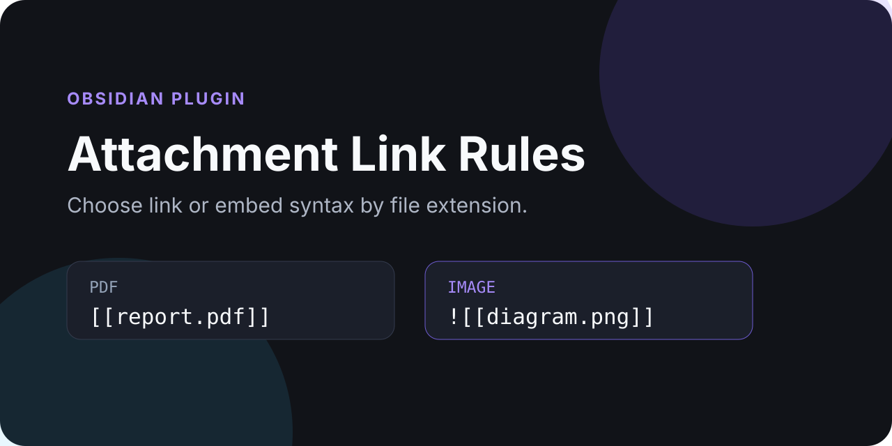
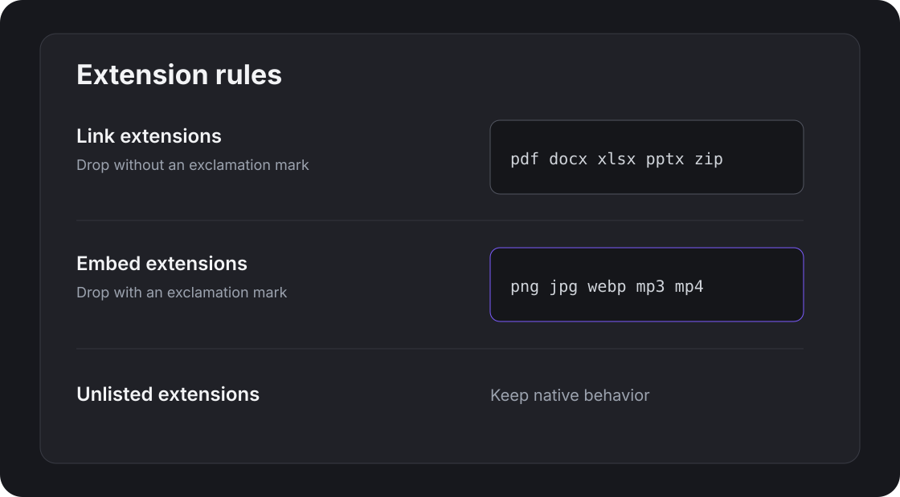

# Attachment Link Rules



Choose whether dropped attachments become normal links or embeds based on their file extension.

A PDF can land as `[[report.pdf]]` while an image still lands as `![[diagram.png]]`. Native attachment storage, filenames, destinations, and the user's Wiki link or Markdown link preference remain intact.

## Highlights

- PDF and office files default to normal links without `!`.
- Images, audio, and video default to embeds with `!`.
- Configure extension lists in the settings screen.
- Unlisted extensions retain the syntax generated by the app.
- Works with external file drops and native vault-file drops because storage stays native.
- Uses public APIs only and does not modify existing notes or attachments.



## Default rules

**Normal links:** `pdf doc docx xls xlsx ppt pptx zip 7z rar`

**Embeds:** `png jpg jpeg gif webp svg avif bmp mp3 wav m4a ogg flac mp4 webm mov`

If an extension appears in both lists, the normal-link rule wins. Extensions are case-insensitive and may be separated by spaces or commas.

## How it works

The app performs its normal drop operation first, including choosing the attachment folder, resolving duplicate filenames, and generating Wiki or Markdown link syntax. The plugin then inspects only the newly inserted text and adds or removes the leading `!` according to the configured extension rules.

This avoids private editor internals and avoids reimplementing attachment storage.

## Installation

Install from the Community directory, or copy the three release files for a manual test-vault installation. No package manager or external service is required at runtime.

### Community plugins

Install the published plugin:

1. Open **Settings → Community plugins → Browse**.
2. Search for **Attachment Link Rules**.
3. Install and enable it.

### Manual installation

Copy these release assets into `.obsidian/plugins/attachment-link-rules/` inside a test vault first:

- `main.js`
- `manifest.json`
- `styles.css`

Restart the app or reload community plugins, then enable **Attachment Link Rules**.

## Usage

Drag an attachment into an open Markdown note as usual. The app stores the file and inserts its normal link. The plugin then applies the configured rule to the newly inserted syntax:

- dropping `report.pdf` produces `[[report.pdf]]` with the default settings;
- dropping `diagram.png` produces `![[diagram.png]]`;
- dropping an unlisted extension keeps the native result.

The same rule engine supports Wiki links and Markdown links. Existing links elsewhere in the note are left untouched.

## Configuration

Open **Settings → Attachment Link Rules**:

On Obsidian 1.13 and later, these options are also indexed by the built-in settings search. Older supported versions continue to use the same settings through the legacy-compatible interface.

- **Link extensions** removes the leading `!`.
- **Embed extensions** ensures the leading `!` is present.
- **Unlisted extensions** keep native behavior.
- **Restore defaults** resets the two lists.

## Development and verification

```bash
npm install
npm run lint
npm run typecheck
npm test
npm run build
npm run community:check
npm run sync:test-vault
npm run smoke:test-vault
```

`npm run check` runs the complete local source and Community preflight. GitHub Actions are intentionally not required; the repository's deterministic gate is documented in [Local validation](docs/local-validation.md). Current Community scorecard findings and their disposition are recorded in [Community scorecard notes](docs/community-scorecard.md).

The test-vault sync refuses paths outside the Windows-local `obsidian-test-vault` plugin folder and refuses the main Syncthing vault.

## Privacy and security

The plugin performs no network requests, collects no telemetry, and does not read attachment contents. Live network access exists only in the development-time Community uniqueness checker.

See [SECURITY.md](SECURITY.md) for reporting guidance.

## Release

The release tag must equal `manifest.json.version`. Each release contains exactly:

- `main.js`
- `manifest.json`
- `styles.css`

See [community submission notes](docs/community-submission.md) and [CHANGELOG.md](CHANGELOG.md).

## License

MIT © 2026 Viggo Meesters.

## Cooperating with Mail Drop (0.2.0)

With Mail Drop 0.10.0 or later, choose **Use attachment rules** in Mail Drop. Mail Drop saves and names external files; Attachment Link Rules chooses link or embed syntax. Internal vault drags keep native storage and naming. Email entries remain owned by Mail Drop. No second attachment copy is created.

For images only as embeds, set **Embed extensions** to `png jpg jpeg gif webp svg avif bmp`, and **Unlisted extensions** to **Use links**. Keep document types in **Link extensions**. Audio, video, unknown extensions and extensionless files then use normal links. Existing settings and the public default rules remain unchanged unless you choose this configuration.

Importers can use the optional synchronous document event `attachment-link-rules:format-v1` with mutable detail `{version:1, fileName, link, handled:false}`. The plugin applies its current rules to the supplied native Wiki or Markdown link and sets `handled:true`. No listener means the caller keeps native syntax. Dispatch on the target note's owner document. The provider also registers for detached windows and removes its listeners on unload.

Before consuming a drop, a cooperating importer dispatches `attachment-link-rules:managed-drop-v1` on that document with `{version:1,event:originalDragEvent}`. The normal drop observer skips that event, including when it ran first. This prevents a second rewrite of a whole mail block and avoids depending on the observer's short retry window for slow file I/O. These events do not install, store or rename attachments.

Runtime evidence identifies the source and bundle hashes for this release.
