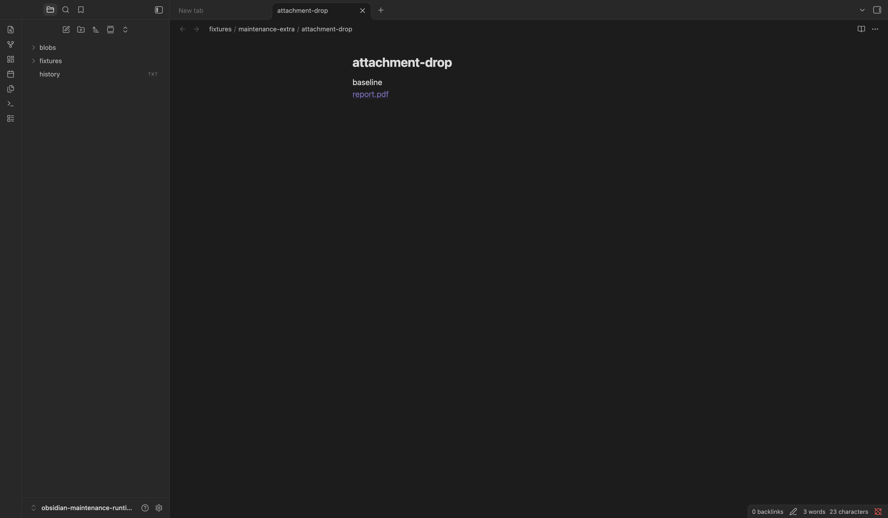

# Obsidian 1.15.1 verification — 16 November 2026

Maintenance patch `0.2.3`. Runtime code is unchanged. The actual desktop host exercised candidate `e7b9ae4ef269912b2bd9361ab05e7c66fc6ff290` with exact source, bundle, manifest and CSS hashes. Production main.js SHA-256: `65b3bed6ce7d077f86d16839157d84e404dea6921d4c0a3a37f4a5510d2e09e9`.

## Exercised behavior

- actual document formatter listener applies PDF/plain, PNG/embed and unlisted default
- real Markdown editor insertion passes through plugin drop observer/editor-change queue
- managed-import protocol prevents duplicate rewrite; authored note restored
- settings restored to defaults, listeners and pending drop timers removed on unload

## Environment and validation

Tests use fictional fixtures in a fresh own synthetic vault on macOS arm64, the actual Obsidian 1.15.1 renderer and Electron 39.8.3. A bounded own bootstrap separates the CLI socket and test profile. Mock keychain is enabled; the regular application/CLI and installed original bytes are checked separately. Own test windows may be visible and remain unfocused. No OS mouse or keyboard input is used. The renderer uses an emulated 1800×1050 viewport; no native window geometry/throttle commands are used.

Ordinary locked `npm ci`, TypeScript checking, production build, existing test scripts and production dependency audit passed. Checked-in official `eslint-plugin-obsidianmd` 0.6.0 recommended checks cover source and metadata; existing repository lint guards are retained where present. Generated/test harness artifacts are outside the official production-source lint scope. Development tooling is not shipped.

## Scope limits

The drop-observer test uses a synthetic event and a real Markdown editor/editor-change queue. It does not establish native OS drag/drop or real mail-provider behavior. Default test settings are restored semantically through the plugin save method; generated synthetic data remains as evidence.

This establishes the exercised 1.15.1 macOS behavior. It does not establish mobile, minimum-version, native-resize, authentication or real keychain behavior. Official Community source/release review, public asset readback and fresh catalog installation remain separate publication gates; a local build or screenshot alone does not establish them.

## Render evidence

